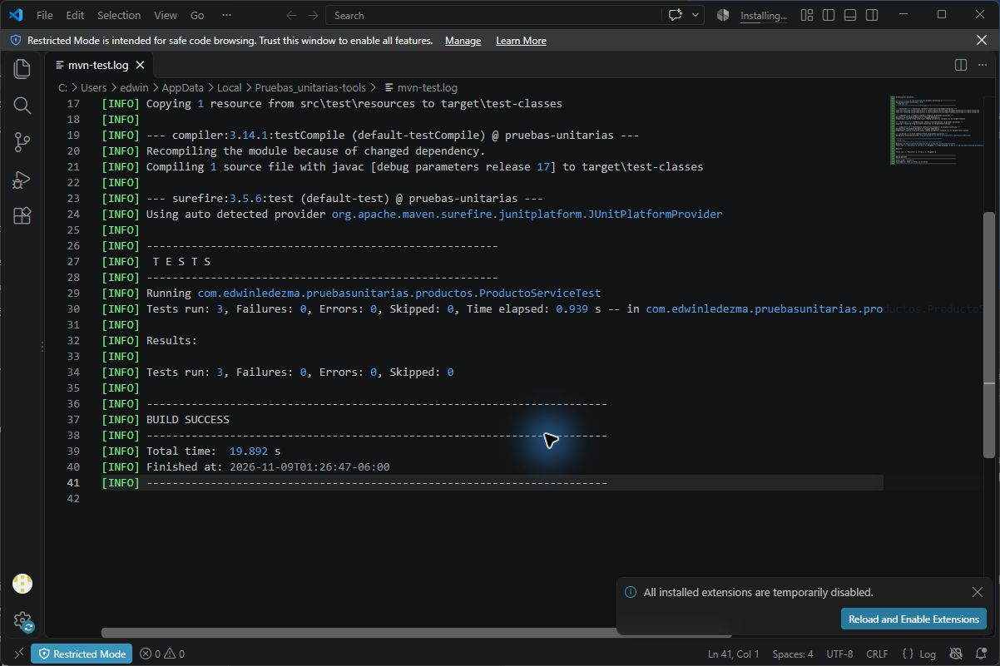

# Pruebas unitarias en Spring Boot

Práctica individual de Edwin Ledezma. La API registra y consulta productos con Spring Data JPA y una base H2 en memoria. Los productos se conservan mientras la aplicación está en ejecución.

## Requisitos

- Java 17 o superior.
- Maven 3.6.3 o superior.
- Spring Boot 3.5.16, fijado en el [pom.xml](pom.xml).

## Ejecutar las pruebas

Desde la raíz del repositorio:

```bash
mvn test
```

[`ProductoServiceTest`](src/test/java/com/edwinledezma/pruebasunitarias/productos/ProductoServiceTest.java) usa JUnit 5, `@Mock` para el repositorio, `@InjectMocks` para el servicio y AssertJ para las comprobaciones. Se ejecuta sin levantar Spring ni conectarse a H2.

| Caso | Comprobación |
| --- | --- |
| `findAll` con productos | Devuelve ambos productos en el orden y con los atributos que entrega el repositorio. |
| `findAll` sin productos | Devuelve una lista vacía. |
| `create` | Envía a `save` un producto nuevo con el nombre y el precio solicitados. Devuelve el producto que entrega el repositorio con su identificador. |

Resultado de Maven: **3 pruebas, 0 fallos, 0 errores y 0 omitidas**.



## Ejecutar la aplicación

```bash
mvn spring-boot:run
```

La API escucha en `http://localhost:8080`.

| Método y ruta | Comportamiento |
| --- | --- |
| `GET /api/productos` | Devuelve `200` con la lista de productos. |
| `POST /api/productos` | Recibe un nombre y un precio positivo. Devuelve `201` con el producto registrado o `400` si los datos son inválidos. |

Ejemplo de cuerpo para el POST:

```json
{
  "nombre": "Monitor",
  "precio": 149.99
}
```

## Flujo de integración

La implementación y la evidencia se integran desde `feature/pruebas-servicio-productos` a `dev`, y desde `dev` a `master`, mediante commits de merge que conservan el historial.
